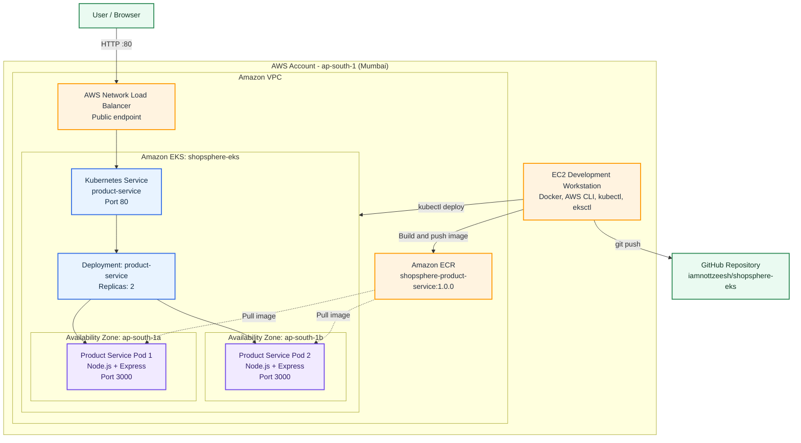

# ShopSphere Architecture

## Request Flow

1. A user opens the public load balancer DNS in a browser.
2. The AWS Network Load Balancer receives the HTTP request on port 80.
3. The Kubernetes `product-service` Service routes the request to a healthy pod.
4. One of two Node.js/Express Product Service pods responds on port 3000.
5. Both pods pull the container image from the private Amazon ECR repository.
6. The EC2 development workstation builds images, pushes them to ECR, deploys Kubernetes manifests, and pushes source code to GitHub.
