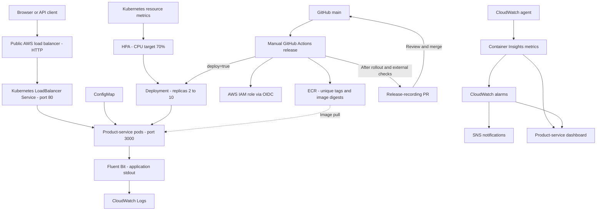

# ShopSphere Architecture

Current application scope: product-service catalog API and static storefront.
Region: ap-south-1. Cluster: shopsphere-eks. Namespace: shopsphere.

This is a logical diagram, not an exact Availability Zone placement map.
The AWS load balancer subtype is not asserted here.

## Request and logging flow

The public Service routes requests to ready backend pods.
Completed responses include X-Request-ID and emit structured JSON logs.
Fluent Bit forwards application logs to CloudWatch.
A public GET /products request was correlated with its CloudWatch event.

## Release flow

The manual workflow builds, smoke-tests, and publishes an image to ECR.
With deploy=true, it deploys by digest and verifies public endpoints.
A separate job opens a PR recording the verified image digest.
Compare the PR with the live Deployment before merging.
Push alone does not trigger the workflow.
Recovery handles rollout failure, not external endpoint-check failure.

## Scaling and limitations

HPA uses Kubernetes resource metrics, not CloudWatch, to scale pods.
The documented scaling cycle was 2 -> 3 -> 2.
Running-pod metrics do not guarantee HTTP availability.
The current public endpoint uses HTTP.
HTTPS, database integration, and additional services remain future scope.
See the validation documents linked from the main README.
